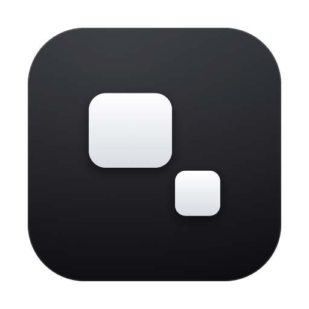
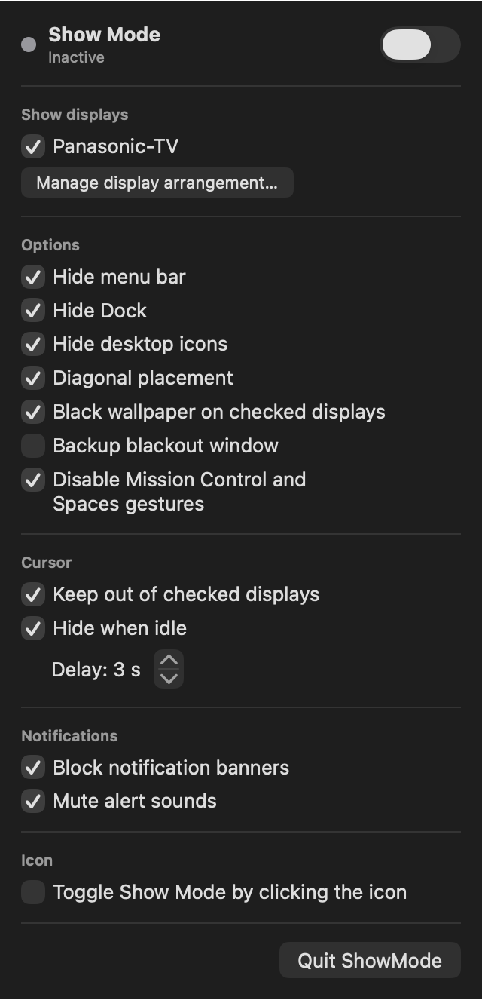

<div align="center">



# ShowMode

**Un seul interrupteur pour que votre Mac ne s'invite jamais à l'écran.**

Curseur, notifications, Dock, icônes du bureau : ShowMode écarte tout ce qui peut polluer vos écrans de projection, puis remet votre Mac exactement comme il était.


**[Site web](https://timothycuenat.github.io/showmode/)** · **[Télécharger](https://github.com/timothycuenat/showmode/releases/latest)**

<br>



</div>

---

## Pourquoi ShowMode

En régie, un curseur qui glisse sur la projection ou une notification en plein spectacle se voit par toute la salle. ShowMode prépare le Mac en un geste, avec QLab ou tout autre logiciel de diffusion.

Il vit discrètement dans la barre des menus : ni fenêtre, ni icône dans le Dock.

## Fonctionnalités

### 🖥️ Écrans

- **Plusieurs écrans de spectacle**, à cocher un par un, même en cours de spectacle
- **Disposition par glisser-déposer**, avec alignement automatique sur les bords
- **Placement en diagonale**, pour que le curseur ne glisse pas sur la projection par accident
- **Fond d'écran noir** sur les écrans cochés
- **Fenêtre Blackout de secours**, entièrement noire

### 🖱️ Curseur

- **Écrans interdits** : le curseur est ramené dès qu'il entre sur un écran coché
- **Masquage après inactivité**, avec un délai réglable de 1 à 60 secondes

### 🔕 Système

- Masquage de la **barre des menus**, du **Dock** et des **icônes du bureau**
- Coupure des **gestes Mission Control et Spaces**
- Blocage des **bannières de notification** et des **sons d'alerte**

### ↩️ Restauration

Chaque valeur d'origine est enregistrée **avant** d'être modifiée. Tout est remis en place à la désactivation, à la fermeture de l'app et, après un plantage, au lancement suivant.

### ⚡ Confort

- **Activation d'un simple clic** sur l'icône, en option (le clic droit ouvre le menu)
- **Interface en français et en anglais**, selon la langue de macOS

## Installation

**[Télécharger l'installateur (.pkg)](https://github.com/timothycuenat/showmode/releases/latest/download/ShowMode-macOS.pkg)**, puis lancez-le. L'icône apparaît dans la barre des menus, en haut à droite de l'écran.

Si macOS bloque l'ouverture, car l'app n'est pas encore notarisée par Apple, allez dans **Réglages Système → Confidentialité et sécurité** et cliquez sur **Ouvrir quand même**.

<details>
<summary>Compiler depuis les sources</summary>

```bash
git clone https://github.com/timothycuenat/showmode.git
open showmode/ShowMode.xcodeproj
```

Appuyez ensuite sur **⌘R**, ou créez l'installateur avec `./packaging/package-macos.sh`.

</details>

## Utilisation

1. Cliquez sur l'icône aux deux écrans dans la barre des menus.
2. Cochez les écrans du spectacle et les options voulues.
3. Activez **Mode Spectacle** avant le début de la représentation.
4. Désactivez-le à la fin : votre Mac revient à son état d'origine.

> [!TIP]
> Activez le mode à l'avance : le Dock et le Finder peuvent redémarrer, et les écrans peuvent clignoter brièvement.

## Limites connues

macOS ne propose pas d'API officielle pour tout ce que fait ShowMode. Testez votre configuration avant un spectacle.

| Sujet | Ce qu'il faut savoir |
|---|---|
| **Fenêtre Blackout** | Elle passe devant les fenêtres normales et peut cacher la sortie vidéo de votre logiciel de diffusion. |
| **Barre des menus** | macOS la masque sur tous les écrans à la fois, y compris l'écran principal. |
| **Gestes** | Ils sont coupés sur tout le Mac, faute de réglage par écran. La touche Mission Control et les coins actifs ne sont pas concernés. |
| **Curseur interdit** | Il peut apparaître un très court instant sur l'écran lors d'un mouvement rapide. |
| **Curseur masqué** | Repose sur une propriété privée de macOS, qu'une mise à jour peut casser. |
| **Bannières** | Notification Center est mis en pause : son panneau ne répond plus, et les bannières retenues s'affichent à la fin. |
| **Focus** | Non pris en charge : macOS en refuse le contrôle direct aux apps tierces. |
| **Mac App Store** | Non compatible : l'app n'est pas dans le bac à sable et utilise des API privées. |

## Structure du projet

```text
ShowMode/
├── App/      Point d'entrée et icône de la barre des menus
├── Core/     Orchestration, options et journal de restauration
├── System/   Écrans, curseur, fond d'écran, notifications, gestes
└── Views/    Menu et éditeur de disposition
Tools/        Génération des icônes
packaging/    Création de l'installateur
docs/         Site web
```

Pour régénérer les icônes :

```bash
swift Tools/generate_icons.swift
```
